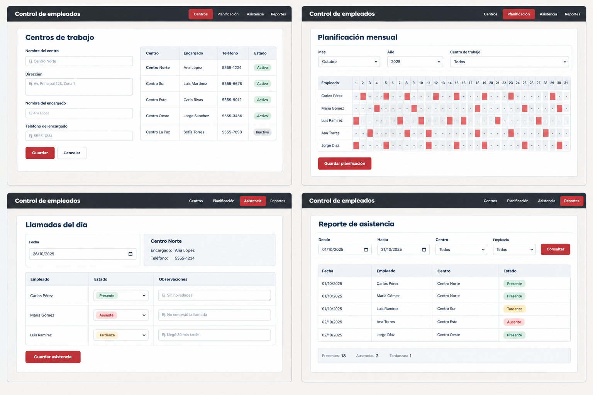

# Diseño propuesto: módulo de asistencia de empleados

## 1. Objetivo

Agregar al sistema de empleados un módulo para:

- Registrar los centros de trabajo y sus encargados.
- Planificar en qué centro trabajará cada empleado cada día del mes.
- Registrar la asistencia después de confirmar los datos por teléfono con el encargado.
- Consultar reportes por fecha, empleado y centro de trabajo.

La asistencia no la marca directamente el empleado, ya que una persona de la empresa llama al encargado y registra lo que este informa.

---

## 2. Suposiciones iniciales

Estas reglas deben confirmarse con la empresa:

1. Cada empleado trabaja en un solo centro por día.
2. La planificación se prepara mensualmente y puede modificarse si hay cambios.
3. Cada centro tiene un encargado y un teléfono de contacto.
4. Una persona de Recursos Humanos realiza las llamadas.
5. Los días libres no generan una llamada de verificación.
6. Los estados de asistencia son: Presente, Ausente, Tardanza y Permiso, el estado Pendiente no se guarda como estado, suponiendo que es el caso de una asignación que todavía no tiene llamada registrada.
7. El sistema guarda quién registró la asistencia y cuándo lo hizo.
8. Los departamentos y empleados ya existen en el sistema.

---

## 3. Base de datos propuesta

Se propone agregar cuatro tablas. Los nombres y tipos de las claves foráneas deben ajustarse a la base de datos existente.

### centros_trabajo

Para guardar los lugares de trabajo y los datos de contacto.

| Campo | Uso |
|---|---|
| id | Identificador del centro, clave primaria |
| codigo | Código único |
| nombre | Nombre del centro |
| direccion | Dirección |
| nombre_encargado | Persona a quien se llama |
| telefono_encargado | Teléfono de contacto |
| activo | Indica si el centro sigue en uso |

### planificacion

Para guardar el centro asignado a cada empleado para una fecha.

| Campo | Uso |
|---|---|
| id | Identificador de la asignación |
| empleado_id | Empleado asignado |
| centro_id | Centro de trabajo |
| fecha | Día planificado |

Debe existir como máximo una asignación por empleado y fecha. Se puede hacer con una restricción única sobre (empleado_id, fecha).

### estados_asistencia

Catálogo de estados permitidos.

| Campo | Uso |
|---|---|
| id | Identificador del estado |
| nombre | Presente, Ausente, Tardanza o Permiso |

### asistencias

Para guardar el resultado de la llamada para una asignación planificada.

| Campo | Uso |
|---|---|
| id | Identificador del registro |
| planificacion_id | Asignación que se verificó, es única por registro |
| estado_id | Resultado de la verificación |
| observaciones | Comentarios, si hacen falta |
| fecha_llamada | Fecha y hora de la llamada |
| registrado_por | Usuario que registró el resultado |

Si todavía no se ha realizado la llamada, la asignación queda pendiente y no necesita una fila en asistencias. Así se diferencia lo planificado de lo verificado.

### Relaciones

- Un centro de trabajo tiene muchas asignaciones en planificacion.
- Un empleado tiene muchas asignaciones (una por día).
- Una asignación tiene como máximo, un registro de asistencia.
- Un estado puede usarse en muchos registros de asistencia.

---

## 4. Pantallas propuestas

| Pantalla | Para qué sirve | Quién la usa |
|---|---|---|
| Centros de trabajo | Crear, editar y desactivar centros con su encargado y teléfono | Administrador |
| Planificación mensual | Elegir mes y centro, y asignar empleados a los días | Recursos Humanos |
| Llamadas del día | Ver qué empleados deben estar hoy en cada centro y registrar su estado | Quien hace las llamadas |
| Reporte de asistencia | Consultar por fecha, empleado y centro | Recursos Humanos |

### Planificación mensual

- Filtros: mes, año y centro de trabajo.
- Cada empleado se asigna a un centro por día.
- Se sugiere poder asignar un rango de fechas de una sola vez (por ejemplo, de lunes a viernes) para no marcar día por día.
- Si el empleado ya está asignado a otro centro ese día, el sistema avisa.

### Llamadas del día

1. Muestra la fecha de hoy y la lista de centros con el nombre y teléfono del encargado.
2. Al elegir un centro, aparecen los empleados planificados ese día.
3. Cada empleado tiene un selector de estado y un campo de observaciones.
4. Al guardar, se registran los estados de ese centro.
5. Los centros que todavía no se han llamado se muestran como pendientes.

### Reporte de asistencia

- Filtros: rango de fechas, centro y empleado.
- Resultado: tabla con fecha, empleado, centro, estado y observaciones.

---

## 5. Procesos

### Proceso mensual o la planificación

1. Antes de iniciar el mes, Recursos Humanos entra a la planificación mensual.
2. Selecciona un centro y asigna a sus empleados por día.
3. Repite el proceso con cada centro y verifica que ningún empleado quede sin asignar.
4. Durante el mes puede modificar la planificación si hay cambios.

### Proceso diario, la verificación

1. Recursos Humanos abre las llamadas del día.
2. Elige un centro y llama al encargado al teléfono que aparece en pantalla.
3. Con lo que el encargado informa, marca el estado de cada empleado y guarda.
4. Repite con los demás centros hasta que no quede ninguno pendiente.

### Reglas del proceso

- Solo se registra asistencia de empleados que tengan planificación ese día.
- Un centro con planificación no se elimina, se desactiva.
- Una asistencia puede corregirse, y queda registrado quién la modificó y cuándo.

---

## 6. Consultas para el encargado del proceso

1. ¿Quién prepara la planificación mensual y en qué formato la tiene hoy, ya sea excel o papel?
2. ¿Un empleado puede trabajar en más de un centro el mismo día?
3. ¿Hay turnos u horarios distintos dentro de un mismo centro?
4. ¿Con qué frecuencia cambia la planificación durante el mes y quién autoriza los cambios?
5. ¿Cómo se manejan los días libres, vacaciones y feriados?
6. ¿Solo hay que registrar el estado del día, o se necesita la hora de llegada?
7. ¿A partir de cuántos minutos se considera tardanza?
8. ¿Como se manejan las inasistencias, y si pueden permitirse con alguna autorización del jefe inmediato?
9. ¿Quiénes usarán el módulo y con qué permisos?

---

## 7. Proceso a seguir

Si el diseño es aprobado, el trabajo debe continuar así:

1. Confirmar las suposiciones con las respuestas a las consultas anteriores.
2. Crear las tablas y el esquema de base de datos definitivo.
3. Construir un prototipo con la planificación y las llamadas del día.
4. Agregar los reportes.
5. Revisar si se necesita autenticación y roles de usuario.
